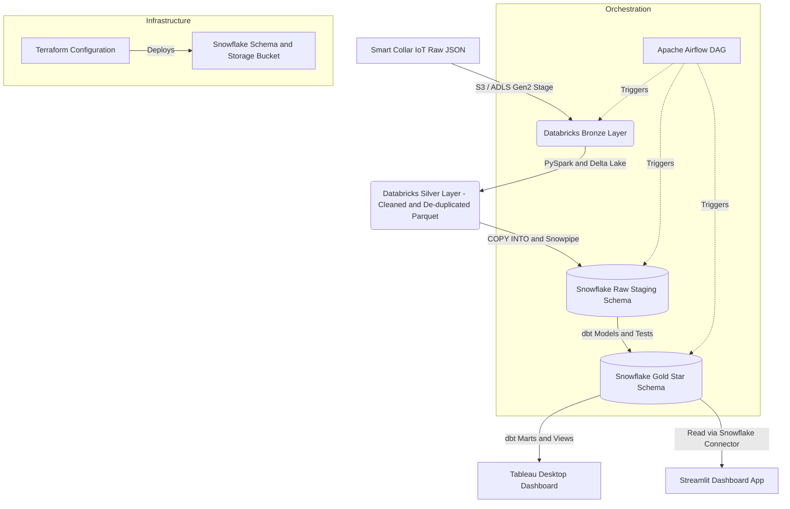

# MeowMetrics: End-to-End Cat IoT Telemetry & Health Analytics Pipeline

MeowMetrics is a modern, production-grade data engineering repository showcasing a complete, multi-stage data pipeline. It simulates the ingestion, cleaning, transformation, and visualization of real-time telemetry from **Smart Cat Collars** (measuring heart rate, sleep duration, play activity, and purr frequency) merged with breed and registration metadata.

This repository serves as a portfolio project demonstrating expertise in **Databricks (PySpark)**, **Snowflake**, **dbt**, **Apache Airflow**, **Terraform**, **Streamlit**, and **Tableau**.

---

## 📐 Project Architecture



### Data Pipeline Flow
1. **Ingestion & Processing (Databricks)**:
   - Raw collar IoT readings arrive in cloud storage as nested JSON files.
   - A Databricks PySpark job checks the schema, parses timestamps, flattens coordinates, filters out telemetry anomalies (e.g. invalid heart rates > 250 BPM or sleep duration > 24 hours), joins with breed registry data, and writes the structured records to Delta Lake format (Silver layer).
2. **Data Warehousing & Load (Snowflake)**:
   - Terraform builds the Snowflake warehouses, databases, schemas, stages, and integration roles.
   - Snowflake staging tables load parquet datasets from the Databricks Silver layer using optimized `COPY INTO` commands.
3. **Data Modeling & Analytics (dbt)**:
   - dbt runs transformations inside Snowflake to convert staging tables into a star schema (Gold layer).
   - Analytical models evaluate sleep metrics, activity levels, and cardiac health by breed.
   - Pre-aggregated database views are exposed to serve BI tools like Tableau.
4. **Visualization (Streamlit & Tableau)**:
   - An interactive Streamlit app queries Snowflake to show live cat statistics.
   - BI dashboards are fed via Tableau.

---

## 🛠️ Technology Stack & Skills Displayed

- **Data Lakehouse**: Databricks (Delta Lake, PySpark / Spark SQL)
- **Cloud Data Warehouse**: Snowflake (External Stages, Warehouses, Storage Integration, COPY INTO)
- **Data Build Tool**: dbt Core (Staging, Dimensions, Facts, Schema Tests, dbt Docs, Custom Singular Tests)
- **Orchestration**: Apache Airflow (Dynamic Tasks, Databricks Operator, Snowflake Operator)
- **Infrastructure as Code**: Terraform (HashiCorp Snowflake & AWS Providers, Workspace setup)
- **Visualization**: Streamlit (Python Data App), Tableau Desktop (BI Dashboard Modeling)
- **CI/CD**: GitHub Actions (Linting with Ruff/Flake8, SQL validation, YAML syntax tests)

---

## 📂 Repository Structure

- `databricks/`: PySpark notebooks for Bronze-to-Silver ETL.
- `snowflake/`: SQL scripts for initial databases, roles, stages, and loading commands.
- `dbt_project/`: Full dbt project containing staging models, dimensions, fact tables, marts, and validation tests.
- `dashboard/`: A Streamlit dashboard application to visualize cat behavior and telemetry.
- `airflow/`: Production Apache Airflow DAG demonstrating pipeline scheduling and orchestration.
- `terraform/`: Infrastructure scripts for automated environment setup.
- `.github/workflows/`: CI/CD automation rules.

---

## 🚀 How to Setup and Run (Local MVP)

### Prerequisites
- **Python 3.10+**
- **Ollama** for local LLM inference: [Install Ollama](https://ollama.com/), then `ollama pull llama3.2` (or `llama3.1:8b`, `qwen2.5:7b`)

---

### 1. Clone & Create Shared Virtual Environment
```bash
git clone https://github.com/YOUR_GITHUB_USERNAME/meowmetrics.git
cd meowmetrics

# Single venv at repo root (dashboard + AI share dependencies)
python -m venv venv
source venv/Scripts/activate  # Windows: venv\Scripts\activate
pip install -r dashboard/requirements.txt
pip install -r ai/requirements.txt
```

### 2. Run the Dashboard (includes AI Copilot)
```bash
streamlit run dashboard/app.py
```
Open http://localhost:8501 — the **AI Copilot panel** is embedded in the dashboard (no separate process).

---

### ⚠️ Why No Bronze/Silver in the Local MVP?

| Layer | Production | Local MVP |
|-------|------------|-----------|
| **Bronze** (raw JSON → Delta Lake) | Databricks PySpark on cloud storage (S3/ADLS) | ❌ Requires Databricks cluster + cloud object store |
| **Silver** (cleaned, deduped Delta) | Databricks Spark + Delta Lake | ❌ Requires Spark runtime + Delta format |
| **Gold** (dbt → Snowflake) | Snowflake + dbt Core | ❌ Requires Snowflake account |
| **Mock Gold** | — | ✅ **`ai/data_access/mock_data.py`** — deterministic synthetic data matching `BI_TABLEAU_VIEWS` schema |

**The architecture diagram above shows the *production* pipeline.** This repo contains all the code for each layer (`databricks/`, `snowflake/`, `dbt_project/`, `airflow/`, `terraform/`), but running Bronze→Silver→Gold locally would require:
- A Databricks workspace (~$500+/mo) or local Spark + MinIO + Delta Lake
- A Snowflake account (free trial works, but extra setup)
- Terraform-provisioned infrastructure

**For portfolio/demo purposes**, the mock Gold layer lets you showcase the **end product** (dashboard + AI copilot + dbt models) working immediately without cloud spend. The dbt models in `dbt_project/models/marts/` are production-ready — point them at a real Snowflake and run `dbt run` to materialize the Gold layer.

### 5. Suggested Prompts for the AI Copilot
The embedded copilot (🤖 Ask the Pipeline) runs a local Ollama model with access to the Gold-layer data and project docs. Try these:

**Data Questions (SQL over Gold layer)**
- "Which cats had heart-rate anomalies yesterday?"
- "Show me the health score for Whiskers last week"
- "List all cats with their breed and average health score"
- "Which breeds have the lowest average activity levels?"
- "Show me sleep vs. activity correlation for overweight cats"
- "What was Garfield's average heart rate over the last 7 days?"

**Pipeline/System Questions (RAG over docs)**
- "How is the daily_feline_health_score calculated?"
- "What does the dbt daily_cat_health model do?"
- "How does the pipeline handle deduplication?"
- "What are the health status categories and their thresholds?"
- "Explain the Bronze → Silver → Gold data flow"

**Model Selector**: Use the dropdown to switch models. `llama3.2:3b` is fast; `llama3.1:8b` or `qwen2.5:7b` are more accurate on complex SQL.

---

### 6. Tableau Dashboard Connection Guide
To visualize the dbt Gold-layer outputs in **Tableau**:
1. **Pre-requisite**: Install the **Snowflake ODBC driver** on your system.
2. In Tableau, select **Connect** -> **To a Server** -> **Snowflake**.
3. Enter your Snowflake connection details:
   - **Server**: `<your_snowflake_account_identifier>.snowflakecomputing.com`
   - **Authentication**: `Username and Password` (or SSO if configured)
   - **Warehouse**: `MEOW_WH`
4. Go to **Database** `MEOW_DB` -> **Schema** `ANALYTICS` and pull in the pre-built `bi_tableau_views` tables (or the stars: `dim_cats` and `fact_collar_readings`).
5. Build worksheets mapping:
   - *Activity Heatmap*: Play activity index versus hour-of-day.
   - *Sleep Metrics by Breed*: Daily average sleep duration grouped by cat breed.
   - *Anomaly Tracker*: Heart rate excursions compared to normal baseline levels.

---

## 📈 Database Schema & dbt Modeling details
We leverage dbt to build clean dimensional models in Snowflake:
- **`dim_cats`**: Cleaned, deduplicated master cat profiles. Contains calculated properties such as human-equivalent age and weight categories.
- **`fact_collar_readings`**: Dense fact table containing hourly aggregates of collar metrics (steps, purrs, heart rate, sleeping seconds).
- **`daily_cat_health`**: Final Gold-level mart which computes rolling health scores based on sleep anomalies and active patterns.

---

*Project created by a Data Engineer as a CV portfolio project to display Databricks, Snowflake, dbt, Airflow, and Cloud Architecture proficiency.*
