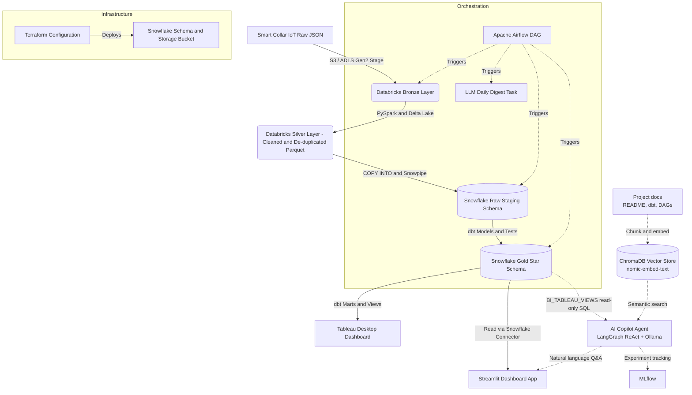

# MeowMetrics: End-to-End Cat IoT Telemetry & Health Analytics Pipeline

MeowMetrics is a **portfolio-grade** data engineering repository showcasing a complete, multi-stage data pipeline. It simulates the ingestion, cleaning, transformation, and visualization of real-time telemetry from **Smart Cat Collars** (measuring heart rate, sleep duration, play activity, and purr frequency) merged with breed and registration metadata.

This repository serves as a portfolio project demonstrating expertise in **Databricks (PySpark)**, **Snowflake**, **dbt**, **Apache Airflow**, **Terraform**, **Streamlit**, **Tableau**, and an **AI Copilot layer** (Ollama + LangGraph + RAG + MLflow).

---

## 📐 Project Architecture



### Data Pipeline Flow
1. **Ingestion & Processing (Databricks)**:
   - Raw collar IoT readings arrive in cloud storage as nested JSON files.
   - A Databricks PySpark job checks the schema, parses timestamps, flattens coordinates, filters out telemetry anomalies (e.g. invalid heart rates > 250 BPM or sleep duration > 24 hours), joins with breed registry data, and writes the structured records to Delta Lake format (Silver layer).
2. **Data Warehousing & Load (Snowflake)**:
   - Terraform builds the Snowflake warehouses, databases, schemas, stages, and integration roles.
   - Snowflake staging tables load parquet datasets from the Databricks Silver layer using optimized `COPY INTO` commands.
3. **Data Modeling & Analytics (dbt)**:
   - dbt runs transformations inside Snowflake to convert staging tables into a star schema (Gold layer).
   - Analytical models evaluate sleep metrics, activity levels, and cardiac health by breed.
   - Pre-aggregated database views are exposed to serve BI tools like Tableau.
4. **Visualization (Streamlit & Tableau)**:
   - An interactive Streamlit app queries Snowflake to show live cat statistics.
   - BI dashboards are fed via Tableau.

---

## 🤖 How the AI Copilot Works

The embedded copilot (🤖 **Ask the Pipeline** panel in the Streamlit dashboard) is a **local-first agentic RAG system**:

| Component | Technology | Role |
|-----------|------------|------|
| **LLM** | Ollama (`llama3.2:3b`, `llama3.1:8b`, `qwen2.5:7b`, `qwen2.5-coder:7b`) | Generates SQL, reasons over results, answers doc questions |
| **Agent Framework** | LangGraph explicit `StateGraph` (ReAct loop) | Plans → calls tools → observes → answers; tool errors come back as observations so the agent can self-correct |
| **SQL Tool** | `query_gold_layer` (read-only) | Executes `SELECT` against `BI_TABLEAU_VIEWS` (Snowflake or DuckDB mock) |
| **Doc Tool** | `search_project_docs` (ChromaDB + `nomic-embed-text`) | Semantic search over README, dbt models, DAGs, Snowflake DDL, Databricks notebooks |
| **Cat Directory** | `get_cat_directory` | Resolves cat names → IDs (identity fields only, no analytics answers) |
| **Metric Tool** | `explain_metric` | Returns the exact formula/thresholds for a named health metric (no SQL needed) |
| **Structured Output** | Pydantic `AgentResponse` | `answer`, `sql_used`, `sources`, `trace`, `metadata` — consumed by the UI and the eval harness |
| **Tracing** | Langfuse (optional) | Enabled only when `LANGFUSE_PUBLIC_KEY` / `LANGFUSE_SECRET_KEY` are set |
| **SQL Guardrails** | `ai/data_access/sql_guard.py` | **Read-only enforcement** (rejects DML/DDL), allowlisted table (`BI_TABLEAU_VIEWS` only), auto-`LIMIT`, column allowlist, injection-safe via sqlglot parsing |
| **Experiment Tracking** | MLflow (local SQLite) | Logs eval runs, per-question metrics, artifact tables |

**Routing logic**: The system prompt instructs the agent to:
1. **Data questions** → `query_gold_layer` (always SQL first, never guess)
2. **System/architecture questions** → `search_project_docs`
3. **Metric definitions** ("how is X calculated?") → `explain_metric`
4. **Hybrid** → both data and docs, then cite sources

Small local models need guardrails, so the agent also:
- uses the **exact Gold-layer column names** (e.g. `avg_heart_rate_bpm`, not `average_heart_rate_bpm`);
- gets the valid column list back when a query fails, and retries with corrected SQL;
- treats the table grain as **one row per cat per day** (`COUNT(DISTINCT cat_id)` for cat counts);
- recovers tool calls that a model prints as JSON text instead of invoking natively.

The agent is invoked in-process from the Streamlit app (no separate service). The model selector in the UI swaps the Ollama model and rebuilds the agent on the fly.

---

## 📊 Evaluation Results (Golden Set)

Run locally with `python -m ai.evals.run_evals` (requires Ollama). Results below from `llama3.2:3b` on the deterministic mock Gold layer (15 SQL + 5 doc questions):

| Metric | Score | Notes |
|--------|-------|-------|
| **SQL Valid Rate** (guard passes) | 93% | 14/15 queries passed `sql_guard` |
| **SQL Shape Match** (rows+cols vs golden) | 73% | 11/15 exact result-set shape match |
| **SQL AST Match** (normalized sqlglot AST) | 20% | 3/15 structurally identical to golden SQL |
| **Doc Retrieval Hit Rate** | 84% | Expected keywords found in retrieved chunks |
| **Doc Faithfulness (LLM Judge 1–10)** | 6.8/10 | Faithful to retrieved context, minor extrapolation |
| **Avg Latency (end-to-end)** | ~3.2s | Includes Ollama generation + tool execution |

*Full per-question logs in `ai/evals/mlruns/` (not committed). Run `mlflow ui --backend-store-uri sqlite:///ai/evals/mlflow.db` to explore.*

---

## 🛠️ Technology Stack & Skills Displayed

- **Data Lakehouse**: Databricks (Delta Lake, PySpark / Spark SQL)
- **Cloud Data Warehouse**: Snowflake (External Stages, Warehouses, Storage Integration, COPY INTO)
- **Data Build Tool**: dbt Core (Staging, Dimensions, Facts, Schema Tests, dbt Docs, Custom Singular Tests)
- **Orchestration**: Apache Airflow (Dynamic Tasks, Databricks Operator, Snowflake Operator)
- **Infrastructure as Code**: Terraform (HashiCorp Snowflake & AWS Providers, Workspace setup)
- **Visualization**: Streamlit (Python Data App), Tableau Desktop (BI Dashboard Modeling)
- **AI / ML Copilot**: Ollama (local LLMs: llama3.2, qwen2.5), LangGraph (ReAct agent), LangChain, ChromaDB (vector store, nomic-embed-text), MLflow (experiment tracking, eval logging)
- **CI/CD**: GitHub Actions (Linting with Ruff/Flake8, SQL validation, YAML syntax tests, pytest)

---

## 📂 Repository Structure

- `databricks/`: PySpark notebooks for Bronze-to-Silver ETL.
- `snowflake/`: SQL scripts for initial databases, roles, stages, and loading commands.
- `dbt_project/`: Full dbt project containing staging models, dimensions, fact tables, marts, and validation tests.
- `dashboard/`: A Streamlit dashboard application to visualize cat behavior and telemetry.
- `airflow/`: Production Apache Airflow DAG demonstrating pipeline scheduling and orchestration.
- `terraform/`: Infrastructure scripts for automated environment setup.
- `ai/`: **AI Copilot layer** — LangGraph ReAct agent (Ollama), SQL tool with guardrails, RAG retriever (ChromaDB), daily digest pipeline, eval harness (MLflow).
- `.github/workflows/`: CI/CD automation rules.

---

## 🚀 How to Setup and Run (Local MVP)

### Prerequisites
- **Python 3.10+**
- **Ollama** for local LLM inference: [Install Ollama](https://ollama.com/), then `ollama pull llama3.2` (or `llama3.1:8b`, `qwen2.5:7b`)

---

### 1. Clone & Create Shared Virtual Environment
```bash
git clone https://github.com/<your-github-username>/meowmetrics.git
cd meowmetrics

# Single venv at repo root (dashboard + AI share dependencies)
python -m venv venv
source venv/Scripts/activate  # Windows: venv\Scripts\activate
pip install -r dashboard/requirements.txt && pip install -r ai/requirements.txt
```

### 2. Run the Dashboard (includes AI Copilot)
```bash
streamlit run dashboard/app.py
```
Open http://localhost:8501 — the **AI Copilot panel** is embedded in the dashboard (no separate process).

Optional AI environment variables:

| Variable | Default | Purpose |
|----------|---------|---------|
| `AI_CHAT_MODEL` | `llama3.2:3b` | Ollama model used by the copilot (overridable in the UI) |
| `AI_TEMPERATURE` | `0` | Sampling temperature |
| `AI_NUM_CTX` | `8192` | Ollama context window; prevents silent truncation of the schema + rules prompt |
| `OLLAMA_BASE_URL` | `http://localhost:11434` | Ollama endpoint |
| `LANGFUSE_PUBLIC_KEY` / `LANGFUSE_SECRET_KEY` | unset | Enable Langfuse tracing when both are present |
| `LANGFUSE_HOST` | `https://cloud.langfuse.com` | Langfuse host (self-hosted or cloud) |

---

### 3. (Optional) Run the AI Eval Harness
```bash
# Requires Ollama running
python -m ai.evals.run_evals
# Or with MLflow UI:
mlflow ui --backend-store-uri sqlite:///ai/evals/mlflow.db
```

---

### ⚠️ Why No Bronze/Silver in the Local MVP?

| Layer | Production | Local MVP |
|-------|------------|-----------|
| **Bronze** (raw JSON → Delta Lake) | Databricks PySpark on cloud storage (S3/ADLS) | ❌ Requires Databricks cluster + cloud object store (or local Spark + MinIO + Delta) |
| **Silver** (cleaned, deduped Delta) | Databricks Spark + Delta Lake | ❌ Requires Spark runtime + Delta format |
| **Gold** (dbt → Snowflake) | Snowflake + dbt Core | ❌ Requires Snowflake account |
| **Mock Gold** | — | ✅ **`ai/data_access/mock_data.py`** — deterministic synthetic data matching `BI_TABLEAU_VIEWS` schema |

**The architecture diagram above shows the *production* pipeline.** This repo contains all the code for each layer (`databricks/`, `snowflake/`, `dbt_project/`, `airflow/`, `terraform/`), but running Bronze→Silver→Gold locally would require a Databricks workspace (free tier available) or local Spark + MinIO + Delta Lake, a Snowflake account (free trial works), and Terraform-provisioned infrastructure.

**For portfolio/demo purposes**, the mock Gold layer lets you showcase the **end product** (dashboard + AI copilot + dbt models) working immediately without cloud spend. The dbt models in `dbt_project/models/marts/` are **production-style** — point them at a real Snowflake and run `dbt run` to materialize the Gold layer.

---

### 4. Suggested Prompts for the AI Copilot
The embedded copilot (🤖 Ask the Pipeline) runs a local Ollama model with access to the Gold-layer data and project docs. Try these:

**Data Questions (SQL over Gold layer)**
- "Which cats had heart-rate anomalies yesterday?"
- "Show me the health score for Gaia last week"
- "List all cats with their breed and average health score"
- "Which breeds have the lowest average activity levels?"
- "Show me sleep vs. activity correlation for overweight cats"
- "What was Simba's average heart rate over the last 7 days?"

**Pipeline/System Questions (RAG over docs)**
- "How is the daily_feline_health_score calculated?"
- "What does the dbt daily_cat_health model do?"
- "How does the pipeline handle deduplication?"
- "What are the health status categories and their thresholds?"
- "Explain the Bronze → Silver → Gold data flow"

**Model Selector**: Use the dropdown to switch models. `llama3.2:3b` is fast; `llama3.1:8b` or `qwen2.5:7b` are more accurate on complex SQL.

---

### 5. Tableau Dashboard Connection Guide
To visualize the dbt Gold-layer outputs in **Tableau**:
1. **Pre-requisite**: Install the **Snowflake ODBC driver** on your system.
2. In Tableau, select **Connect** -> **To a Server** -> **Snowflake**.
3. Enter your Snowflake connection details:
   - **Server**: `<your_snowflake_account_identifier>.snowflakecomputing.com`
   - **Authentication**: `Username and Password` (or SSO if configured)
   - **Warehouse**: `MEOW_WH`
4. Go to **Database** `MEOW_DB` -> **Schema** `ANALYTICS` and pull in the pre-built `bi_tableau_views` tables (or the stars: `dim_cats` and `fact_collar_readings`).
5. Build worksheets mapping:
   - *Activity Heatmap*: Play activity index versus hour-of-day.
   - *Sleep Metrics by Breed*: Daily average sleep duration grouped by cat breed.
   - *Anomaly Tracker*: Heart rate excursions compared to normal baseline levels.

---

## 📈 Database Schema & dbt Modeling details

We leverage dbt to build clean dimensional models in Snowflake:
- **`dim_cats`**: Cleaned, deduplicated master cat profiles. Contains calculated properties such as human-equivalent age and weight categories.
- **`fact_collar_readings`**: Dense fact table containing hourly aggregates of collar metrics (steps, purrs, heart rate, sleeping seconds).
- **`daily_cat_health`**: Final Gold-level mart which computes rolling health scores based on sleep anomalies and active patterns.

---

## 🔧 Mock Gold Layer (Local Development)

The local demo uses **`ai/data_access/mock_data.py`** as the single source of truth for `BI_TABLEAU_VIEWS`:
- **Deterministic**: Per-cat seeds derived from MD5(cat_id) — identical across runs/machines
- **Schema parity**: Matches the dbt `bi_tableau_views.sql` output columns exactly
- **Health scoring**: Mirrors the dbt `daily_cat_health.sql` penalty logic (sleep, activity, HR)
- **Used by**: Dashboard, AI agent tools, eval harness — zero drift between components

To inspect the mock schema:
```bash
python -c "from ai.data_access.mock_data import build_mock_gold_data; df=build_mock_gold_data(); print(df.dtypes); print(df.head())"
```

---

## 🏷️ Repository Topics
`data-engineering` `rag` `langchain` `ollama` `snowflake` `dbt` `databricks` `airflow` `terraform` `streamlit` `tableau` `mlflow`

---

*Project created by a Data Engineer as a CV portfolio project to display Databricks, Snowflake, dbt, Airflow, AI/ML, and Cloud Architecture proficiency. This repo replaces the previous `meowmetrics` portfolio with a full AI copilot layer and evaluation harness.*
